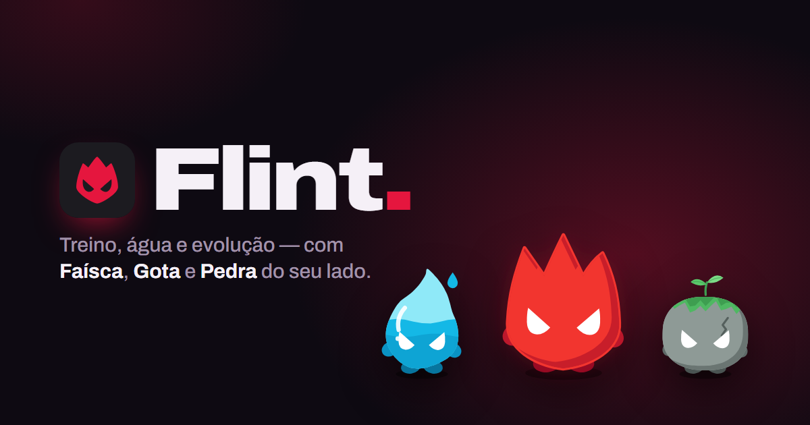
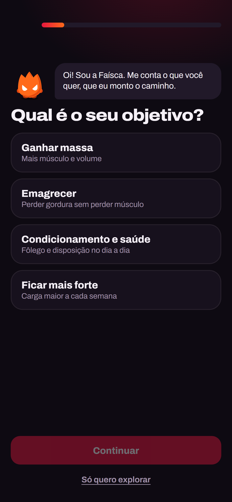
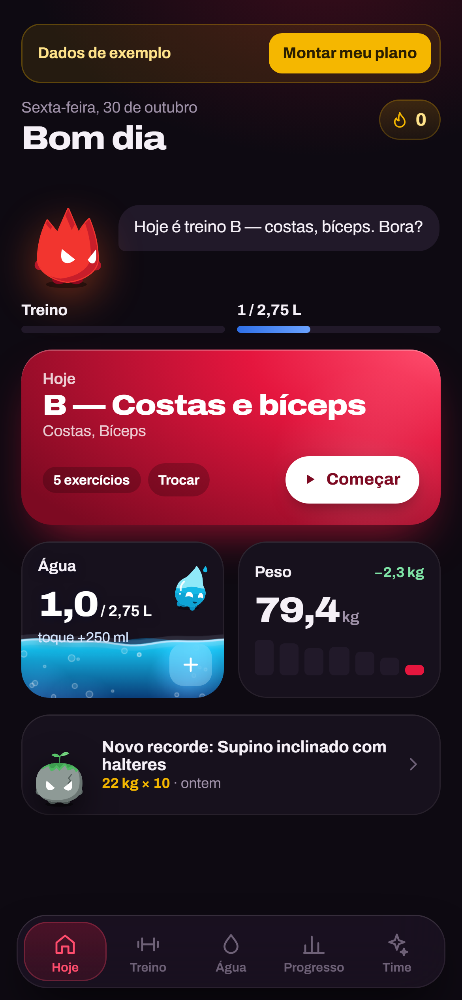
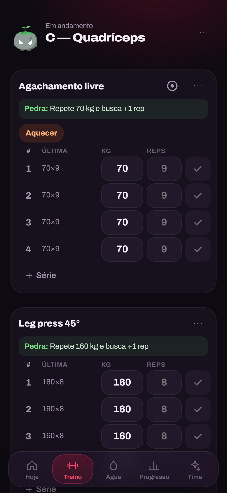
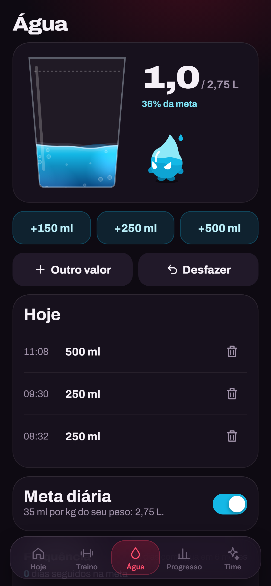
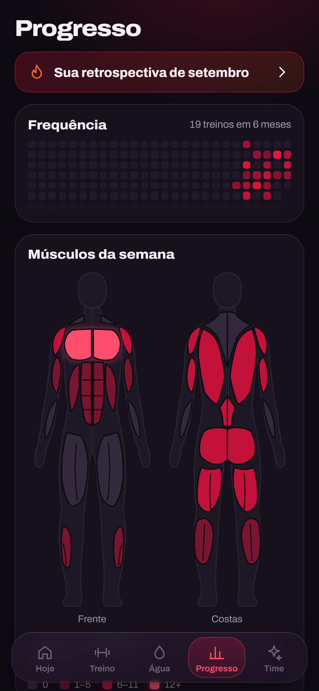
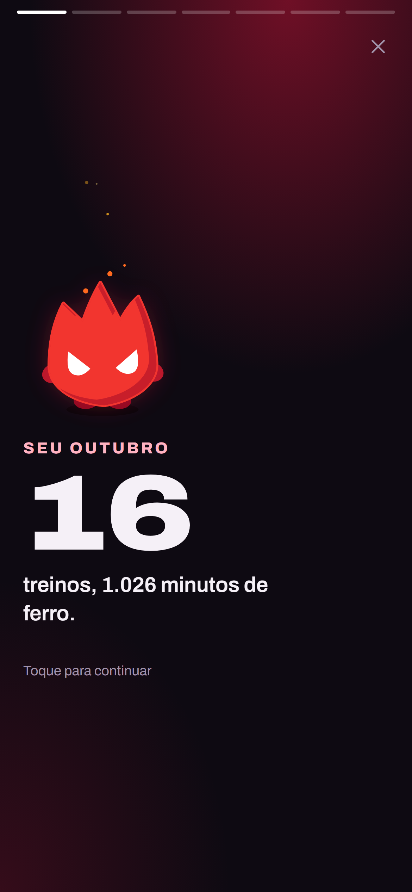
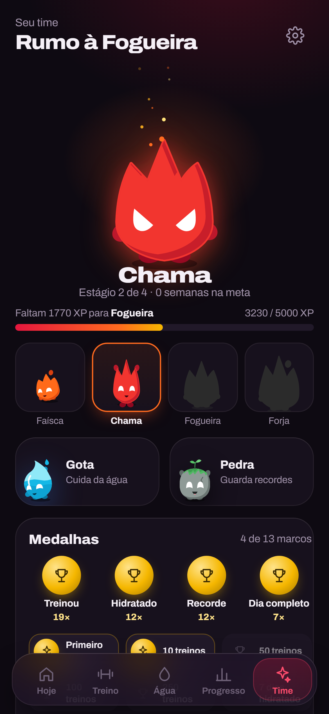
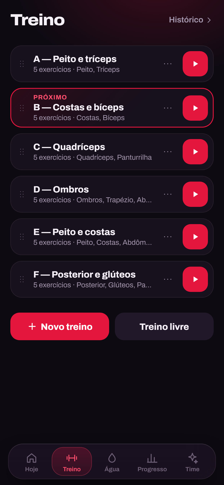

<p align="center"></p>

> **English summary.** Flint is an offline-first gym tracker for iPhone, built as a PWA. A short first-run survey builds a routine for your goal, schedule and equipment, plus a water goal from your weight. You log sets with a rest timer, plate calculator and automatic warm-ups, get plateau warnings and goal forecasts, track water on its own screen, share PR cards and a monthly recap, and watch three mascots react to how you train. Faísca, a little flame, evolves from orange to blue as you earn XP. Everything stays on the device in IndexedDB; there's no account and no server. React 19 + TypeScript + Dexie + Vite.

# Flint

App de academia feito para o iPhone, instalável pela tela de início. Ele é pensado para o meio do treino: abrir, marcar a série, descansar e seguir.

**Demo:** https://kevinhsdev.github.io/flint/. No iPhone, abra no Safari e toque em *Compartilhar → Adicionar à Tela de Início*.

<p align="center">
  
  
  
  
</p>
<p align="center">
  
  
  
  
</p>

## O que tem

- **Pesquisa inicial.** Oito perguntas rápidas, uma por tela (objetivo, experiência, dias, tempo, onde treina, peso, altura, idade e horário). Com elas o app monta um plano pronto: a divisão pelos dias, os exercícios pelo equipamento e as repetições e o descanso pelo objetivo. Depois vem a sequência "Seu plano": IMC explicado sem julgamento, sua estratégia, sua meta de água e o que esperar em 4, 8 e 12 semanas. A pesquisa pode ser refeita em Ajustes.
- **Rotina do seu jeito.** O plano gerado é só o começo: você edita, cria treinos (A, B, C… quantos quiser) e reordena arrastando. O app sabe qual é o próximo da sequência.
- **Treino em andamento:**
  - séries com carga, reps e a coluna "última vez";
  - a Pedra sugere a próxima carga (sobrecarga progressiva);
  - **aquecimento automático:** barra vazia, 50% e 75% da carga de trabalho, arredondados pelas anilhas e fora do volume e dos recordes;
  - **detector de platô:** se a carga não sobe há 3 semanas, a Pedra sugere um deload ou uma variação;
  - descanso flutuante com −15/+15 s;
  - calculadora de anilhas;
  - recorde destacado em ouro na hora, com **cartão para os Stories**.
- **Água.** Tela própria: um copo que enche, botões de 150/250/500 ml ou valor livre, registros do dia, meta automática (35 ml/kg) ou manual e um mapa de frequência com a sequência de dias na meta. No Hoje, um toque no card soma 250 ml.
- **Progresso:**
  - mapa de calor de 6 meses;
  - corpo anatômico (frente e costas) com as séries da semana por músculo;
  - gráfico por exercício (carga máx, 1RM estimado e volume) com **meta de carga**: "no ritmo atual, ~N semanas";
  - **retrospectiva do mês** em telas no estilo Stories, com uma imagem para compartilhar;
  - peso com média móvel e IMC;
  - fotos comparadas lado a lado.
- **Time de mascotes.** Desenhados no estilo da logo. A Faísca evolui com o seu XP: laranja, vermelho, roxo e azul. A Gota fica triste se você não beber água e a Pedra, um seixo com musgo, comemora os seus recordes. Há medalhas diárias e marcos.
- **Sons sutis.** Gerados na hora com Web Audio, sem arquivos: série feita, recorde, gole d'água e fim de treino. Dá para desligar em Ajustes.
- **Seus dados, no seu celular.** Funciona offline e tem backup em JSON para exportar e importar. Não precisa de conta.

Na primeira abertura aparece a pesquisa. Quem só quer conhecer o app toca em **Só quero explorar** e recebe 5 semanas de dados de exemplo; depois, **Montar meu plano** troca o exemplo pelos seus dados.

## Decisões técnicas

- **Água com molas acopladas.** A superfície é uma fileira de 40 molas. Cada toque empurra algumas delas e a onda se espalha pelas vizinhas, como na "água dinâmica 2D" de jogos. Por cima entram bolhas, cáusticas e menisco, num `<canvas>` com `devicePixelRatio`. A animação pausa quando o card sai da tela (`IntersectionObserver`).
- **Mascotes num rig 2.5D em SVG.** Cada parte do corpo é um grupo com molas próprias: squash, stretch, yaw/pitch da cabeça e bracinhos. Os comportamentos (boxe, polichinelo, rosca, dança…) são curvas sobre essas molas. Um único `requestAnimationFrame` serve a todos os mascotes da tela. Dá para tocar (cócegas), arremessar e fazer carinho.
- **Conquistas derivadas do histórico.** XP, recordes, medalhas, sequência e humor dos mascotes não ficam gravados. São funções puras sobre as sessões salvas. Apagar ou editar um treino antigo recalcula tudo, sem estado para dessincronizar.
- **Dados locais.** IndexedDB via Dexie, com `navigator.storage.persist()`. O treino em andamento é gravado a cada série e sobrevive se o app fechar. O descanso conta a partir de um timestamp de fim, então continua certo com o app em segundo plano.
- **Plano por regras, sem IA.** A geração do treino é determinística e roda offline: divisão por dias (full body, ABC, superior/inferior, ABCDE, PPL), exercícios filtrados pelo equipamento e, para iniciantes e quem tem 50 anos ou mais, máquinas antes de barra livre.
- **Imagens em canvas.** O cartão de recorde e a retrospectiva são desenhados em 1080×1920 no próprio aparelho. O mascote é o SVG do rig serializado, então funciona sem rede.
- **Datas pelo dia local.** "Hoje" é sempre o dia do relógio da pessoa, nunca UTC.

## Stack

React 19 · TypeScript · Vite · react-router (HashRouter) · Dexie · vite-plugin-pwa · Vitest + Testing Library · fonte Archivo. O deploy vai para o GitHub Pages via Actions.

## Rodando

```bash
npm i
npm run dev      # http://localhost:5173
npm test         # testes
npm run build    # gera dist/ com service worker
```

## Licença

MIT
